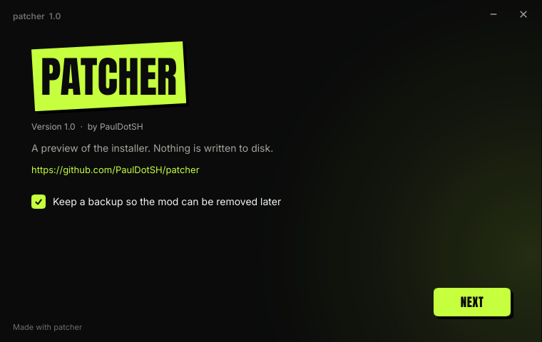

<p align="center">
  
</p>

<p align="center">
  <b>Ship game mods without shipping the game.</b><br>
  Diff your modded game against the original and hand players a small patch and a one-click patcher.
</p>

---

Modders usually can't redistribute a game, yet many mods change the executable, packed
archives and hundreds of assets. Patcher lets you publish only the difference:

```text
patcher create --base PvZ-original --modded PvZ-mymod --name "My Mod"

  MyMod.patch            the compressed difference
  MyMod-patcher.exe      self-contained installer for Windows (stub + patch)
  MyMod-patcher          self-contained patcher for Linux
```

Players double-click `MyMod-patcher.exe` next to their own copy of the game. An installer
window finds the game, checks that it is the right version, patches it, verifies every
file, and keeps a backup so the mod can be removed again.

<p align="center">
  
</p>

## Highlights

- **Small patches.** Every changed file is encoded several ways and the smallest
  wins, unless an encoding that decodes faster is within 5 % of it:
  - zstd and LZMA2 using the original file as a dictionary;
  - bsdiff;
  - an x86 branch filter for executables;
  - plain compression.

  New small files are packed into solid blocks. Moved files cost almost nothing, and
  moved-and-edited files are diffed against their old location.
- **Fast apply.** Decoding is parallel and memory-bounded. Applying is typically several
  hundred MB/s of output (see [benchmarks](#benchmarks)).
- **Safe.** Apply first verifies the game files (size + xxh3, plus BLAKE3 unless the
  author opts out), then writes into a staging folder, checks every output, and swaps
  files in with renames. Failures roll back. Corrupt or hostile patches are rejected
  rather than crashing, and paths can never leave the game folder.
- **Reversible.** Originals are kept in `.patcher-backup/` and `--revert` restores the
  game exactly. Re-running is detected ("already applied").
- **Big files.** Files over 512 MiB are encoded in 64 MiB chunks, each matched against
  the right region of the original. A 3 GB file with a few MB of edits patches to about
  12 MB.
- **An installer, your way.** Patchers open an installer window with a progress bar,
  game-folder detection, cancel, remove-the-mod and a Launch button. Its look is a theme:
  one line of TOML changes the accent colour, and [Slint](https://slint.dev) files can
  replace any part of the window or all of it ([docs/gui.md](docs/gui.md)). Console
  patchers are one flag away.
- **Cross-platform.** Windows and Linux. The console stub is pure Rust: about 640 KB on
  Windows and a 1.1 MB static binary on Linux; the installer stub is about 12 MB. Off
  Windows, paths match case-insensitively, so a mod made on Windows still applies.

## For mod authors

Get `patcher.exe` (or build it with `cargo xtask dist`). It already contains the Windows
and Linux stubs.

```sh
patcher create --base "C:/Games/PvZ-clean" --modded "C:/Games/PvZ-mymod" \
    --name "My Mod" --mod-version 1.0 --author you -o dist
```

You can keep metadata and settings in a file and pass it with `--config patch.toml`
(see [`patch.example.toml`](patch.example.toml)):

```toml
name = "My Mod"
version = "1.0"
author = "you"
description = "Adds things."
url = "https://example.com/mymod"
exclude = ["saves/", "*.bak"]
profile = "balanced"   # fast | balanced | max
```

| flag | effect |
|---|---|
| `--dry-run` | list what changed (modified, moved, added, deleted) without encoding |
| `--profile fast\|balanced\|max` | `fast`: zstd only, seconds. `balanced` (default): every strategy. `max`: every strategy, always the smallest |
| `--tolerance 5` | percent a faster-to-decode encoding may lose in size and still be chosen |
| `--no-verify` | skip per-file BLAKE3 (smaller, faster); size + xxh3 is still checked |
| `--exclude GLOB` | leave paths out (gitignore syntax, repeatable); `<modded>/.patcherignore` is read too |
| `--target windows\|linux\|all` | which standalone patchers to build (default `all`) |
| `--ui gui\|cli` | installer window (default) or console patcher |
| `--gui theme.toml` | theme for the installer window, see [docs/gui.md](docs/gui.md) |
| `--detached` | patchers without the patch inside; they read the `.patch` next to them |
| `--no-standalone` | only write the `.patch` |
| `--max-mem 8G` | memory budget for the encoders (default 75 % of RAM) |
| `--report report.md` | per-file table of every candidate encoding and its size |

Other commands:

```sh
patcher info   MyMod.patch [--json]    # metadata and every file operation
patcher verify MyMod.patch GAME        # unpatched / patched / mismatch (with the differing files)
patcher apply  MyMod.patch GAME [--no-backup] [--out DIR] [-y]
patcher revert GAME
patcher gui-preview [--gui theme.toml]  # preview a theme; reloads when its files change
```

Junk such as `Thumbs.db`, `.DS_Store`, `.git/` and `*.log` is excluded automatically.

## For players

Double-click `MyMod-patcher.exe`. It looks for the game where the author said it usually
is, next to itself and in the current folder; otherwise pick the folder. Press Patch.
Reopening it later offers to remove the mod.

From a terminal, or with a console patcher (`--ui cli`), pass the game folder:

```text
MyMod-patcher.exe ["C:/Games/Plants vs. Zombies"] [-y | --silent] [--no-backup] [--out DIR]
MyMod-patcher.exe --verify      check whether the game matches
MyMod-patcher.exe --revert      restore the original game
MyMod-patcher.exe --info        list what the patch changes
```

If the game isn't next to the patcher or in the current folder, the patcher asks for
it. A patcher without an embedded patch uses the single `.patch` file next to it, or
the one given with `--patch FILE`.

## Benchmarks

The numbers come from a synthetic 218 MiB game and five mod scenarios (24 threads,
Windows, NVMe). "Baseline" is what shipping just the changed files would cost:
`zstd -19 --long` over every changed or added file.

| scenario | changed | baseline | **patch** | apply |
|---|---:|---:|---:|---:|
| 24 byte patches in the exe | 10.2 MiB | 4.38 MiB | **1022 B** | 0.02 s |
| 64 KiB of code inserted, all later calls shifted | 10.3 MiB | 4.41 MiB | **220 KiB** | 0.02 s |
| `main.pak` repacked (30 files edited, 10 added) | 99.5 MiB | 65.7 MiB | **3.65 MiB** | 0.3–0.6 s |
| 300 new assets, edits, moves, deletions | 13.3 MiB | 10.8 MiB | **10.7 MiB** | 0.2–0.3 s |
| all of the above | 123 MiB | 81.8 MiB | **16.0 MiB** | 0.3–0.5 s |
| one 3 GB file, ~12 MB of real changes | 3 GB | | **12.1 MiB** | 20–30 s |

Apply times include verifying the game, decoding, checking outputs and committing with
backups. They vary run to run with Windows file-system activity (antivirus scanning new
files). The `assets` row is barely smaller than the baseline because its new files are
random data, which can't be compressed.
Full tables, profile comparisons and per-file encoder decisions are in
[BENCHMARKS.md](BENCHMARKS.md). Regenerate them with `cargo xtask bench --scale 1 --large 3`.

## How it works

```text
create:  scan both trees -> classify (unchanged / copy / modify / move+edit / add / delete)
         -> encode candidates in parallel under a memory budget -> pick per tolerance rule
         -> blobs + bitcode index (zstd) -> MyMod.patch -> stub ++ patch ++ footer
apply:   verify base files -> decode to .patcher-staging/ (verified) -> back up originals
         -> rename into place -> manifest for --revert   (rolls back on any error)
```

The format, the codecs and every decision are documented in [DESIGN.md](DESIGN.md).

| crate | role |
|---|---|
| `patcher-core` | format, pure-Rust decoders, apply / verify / revert (linked by the stub) |
| `patcher-create` | scanning, classification, encoders, bsdiff, patch writer |
| `patcher-cli` | `patcher`, the author tool |
| `patcher-stub` | the player-side console patcher |
| `patcher-gui` | themes, UI bundles, the built-in Slint layout and the installer runtime |
| `patcher-stub-gui` | the player-side installer window |
| `patcher-testgen` | deterministic synthetic games and mod scenarios |
| `xtask` | `dist`, `gen-corpus`, `gen-large`, `bench` |

## Building

```sh
rustup target add x86_64-unknown-linux-musl
cargo test --release --workspace
cargo xtask dist          # dist/patcher(.exe) with this host's stubs embedded, plus dist/stubs/
```

On Windows, `dist` builds the Windows installer and console stubs and the Linux console
stub (cross-compiled with the `rust-lld` that ships with rustup). The Linux installer stub
needs glibc and is built only on Linux, where `dist` also cross-builds the Windows stubs
with mingw-w64; a Linux-built `patcher` therefore carries all four. The creator links native libzstd, so it needs a C
compiler (MSVC on Windows). CI (`.github/workflows/ci.yml`) runs the tests on Windows
and Linux.

## Status and roadmap

- [x] Create, apply, verify, revert, info; standalone Windows and Linux patchers
- [x] Per-file multi-strategy encoding, solid blocks, move detection, large-file chunking
- [x] Backups, rollback, hostile-patch hardening
- [x] Themeable installer window for players (Slint), with live theme preview
- [ ] Format-aware handling of known archives (e.g. PopCap `.pak`), via the `Transform` slot
- [ ] Patches that accept several base versions, and update patches between mod versions
- [ ] Linux runtime verified in CI (currently compile-checked locally)

## License

[AGPL-3.0-or-later](LICENSE). `vendor/ruzstd` is ruzstd 0.9.1 (MIT) with one added API
(`FrameDecoder::set_raw_prefix`).
