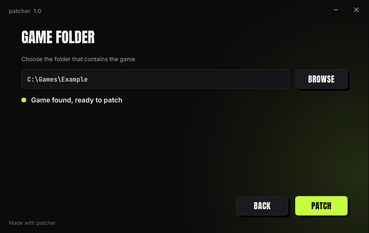
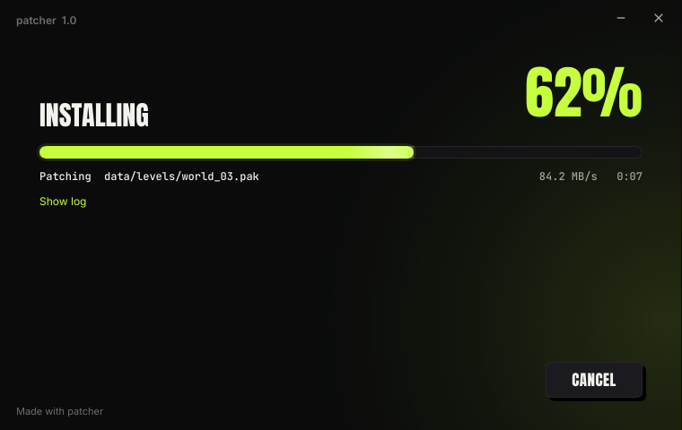
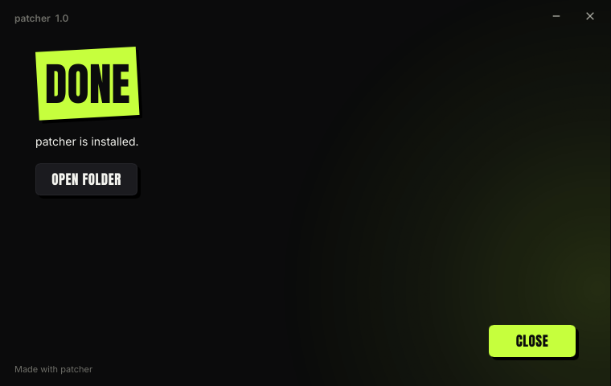
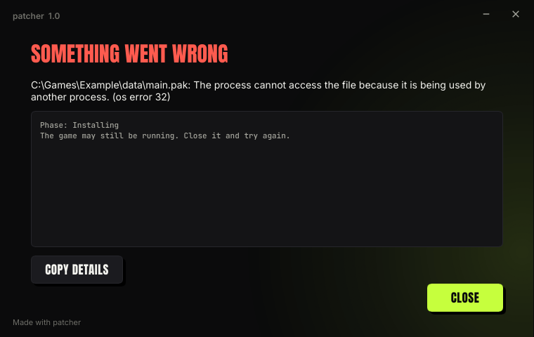
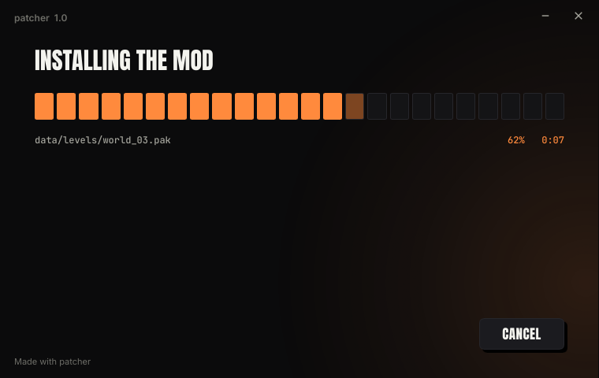
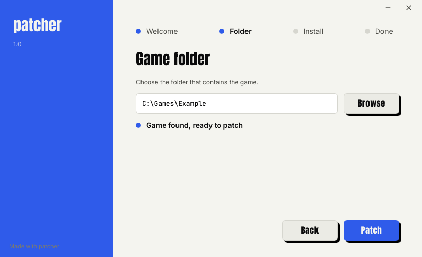

# GUI patchers

By default `patcher create` builds patchers that open an installer window: a welcome
page, a game-folder page, a progress bar and a result page. Players double-click, check
the folder, press Patch, and can launch the game when it is done.


| | |
|---|---|
|  |  |
|  |  |

The look is a theme: a TOML file, plus optional fonts, images and
[Slint](https://slint.dev) files for anything the TOML cannot express. An empty theme
gives the built-in look above.

## Quick start

```sh
mkdir my-theme
echo 'accent = "#ff3366"' > my-theme/theme.toml   # under [theme], see below
patcher gui-preview --gui my-theme/theme.toml        # live preview, reloads on save
patcher create --base Game --modded GameModded --name "My Mod" --gui my-theme/theme.toml
```

A working first theme:

```toml
[window]
icon = "icon.png"

[theme]
accent = "#ff3366"

[paths]
windows = ['%ProgramFiles(x86)%\Steam\steamapps\common\My Game']
linux = ["~/.local/share/Steam/steamapps/common/My Game"]

[launch]
windows = "MyGame.exe"
```

[`gui.example.toml`](../gui.example.toml) lists every key with its default.

## Window or console

| flag | effect |
|---|---|
| `--ui gui` | installer window (default) |
| `--ui cli` | console patcher, as before |
| `--gui theme.toml` | installer window with this theme (implies `--ui gui`) |
| `--detached` | patchers without the patch inside; they read the `.patch` next to them |

The same keys work in a `--config` file: `ui = "cli"`, or `gui = "theme.toml"` (relative
to the config file).

The GUI patcher also runs without a window when given arguments, with the same flags and
output as the console patcher: `--silent GAME_DIR` installs, `--verify` checks, `--revert`
restores. On Windows the output goes to the terminal it was started from.

**Linux.** The Linux GUI patcher is built only by a creator that was itself built on Linux
(see [Building](#building)). A creator built on Windows writes a console patcher for Linux
and says so:

```text
warning: no Linux GUI stub in this build (build the creator on Linux); the Linux patcher will be a console app
```

## The theme file

All keys are optional. Paths are relative to the theme file and must stay inside its
folder: **the whole folder is packed into the patcher** (hidden files excepted, at most
1024 files and 64 MiB), so keep the theme in a folder of its own.

Unknown keys, bad colours and missing files are errors when you run `create`, never
something a player sees.

### Colours

Three levels, each optional:

1. `base = "dark"` or `"light"` picks the neutral colours (background, panels, text).
2. `accent` sets the accent and derives the rest: `accent-ink` (text on the accent: the
   background or text colour, whichever has more contrast), `accent-soft` (10 % alpha)
   and `accent-glow` (35 % alpha).
3. `[theme.colors]` overrides any single colour.

| token | used for |
|---|---|
| `bg` | window background |
| `panel`, `raised` | text fields and boxes; secondary buttons |
| `border`, `border-hover` | outlines |
| `text`, `dim`, `faint` | main text, secondary text, hints |
| `accent`, `accent-ink` | primary buttons, the tag, the progress bar; text on them |
| `accent-soft`, `accent-glow` | glows and selections |
| `ok`, `bad`, `warn` | folder status dots, the error heading |

### Fonts

`[theme.fonts]` takes TTF or OTF files for `display` (wordmark, headings, buttons), `body`
and `mono` (paths and file names). The defaults are Anton, Inter and JetBrains Mono, all
under the SIL Open Font License; their license texts are embedded with them.
`uppercase = false` keeps the display strings as written.

### Wordmark, logo, background

The welcome page shows the mod's name in display type with its last word in the tilted
accent tag. `wordmark` and `tag` change the text (`tag = ""` drops the box), and a `logo`
image replaces both. Long names shrink to fit one line.

`background` is `glow` (a slow drifting accent glow), `grid` (a moving grid), `image`
(with `background_image`) or `none`. Animation runs at up to 30 frames per second and
pauses while the window is unfocused or minimised.

### Screens and text

`[screens]` turns the welcome page and the backup option on or off, and adds a license
page from a text file (`require_accept = true` keeps Next disabled until it is accepted).
Without a license page the backup option sits on the welcome page.

Every text is a key in `[strings]`; `{name}`, `{version}` and `{author}` are filled in.

### Finding the game

The patcher checks, in order: the `[paths]` entries for the player's OS (`~`, `%VAR%` on
Windows and `$VAR` / `${VAR}` on Linux are expanded), the folder the patcher is in, and
the current folder. The first that looks like the game wins. A folder the mod was already
installed in counts too, so players can reopen the patcher to remove the mod.

The path stays editable, and Browse opens the system's folder picker. Every change is
checked: the folder page says whether the game matches, is already patched, or lists the
first files that differ.

### Launching

`[launch]` adds a Launch button to the done page: a program relative to the game folder
per OS, or `steam_app_id` to start the game through Steam.

### The executable on Windows

`[window] icon` (PNG or JPEG; non-square images are padded) becomes the `.exe` icon, and
the mod's name, version and author fill in its version information. Sign the patcher
after `create` if you sign your releases: signing must be the last step.

## Previewing

```sh
patcher gui-preview --gui my-theme/theme.toml
```

opens the installer with a pretend 8-second install. It reloads whenever a file in the
theme's folder changes; Slint errors appear in the terminal and over the window, and the
last working version stays usable.

| flag | effect |
|---|---|
| `--patch FILE` | show this patch's name and details, and check (never apply) it against the game |
| `--game DIR` | start with this folder |
| `--fail` | end the pretend install on the error page |
| `--screenshot DIR` | render every page to `DIR/<page>.png` and exit (no window needed) |

## Custom layouts

When the TOML is not enough, write [Slint](https://slint.dev/docs). Two levels:

- `[layout.parts]` replaces single parts of the built-in window and keeps the rest.
  [`examples/gui/progress-only`](../examples/gui/progress-only) swaps the progress bar for
  a block meter:

  

- `[layout] installer` replaces the whole window content.
  [`examples/gui/full-window`](../examples/gui/full-window) is a light layout with a
  sidebar of steps:

  

### Parts

| key | component | |
|---|---|---|
| `titlebar` | `TitleBar` | drag area, name, minimise and close |
| `background` | `Background` | glow, grid or image |
| `welcome` | `WelcomeScreen` | wordmark, details, link, backup option, remove offer |
| `license` | `LicenseScreen` | license text and accept box |
| `folder` | `FolderScreen` | path field, Browse, status |
| `options` | `OptionsScreen` | backup option |
| `progress` | `ProgressScreen` | bar, phase, file, speed, time left, log |
| `done` | `DoneScreen` | result, Open folder, Launch |
| `error` | `ErrorScreen` | message, details, Copy details |
| `buttons` | `NavButtons` | Back / Next / Patch, Cancel, Close |

A part file exports its component under that name. It takes no properties: it fills the
space it is given and reads the globals below. An `installer` file exports
`component Installer` (any element except a `Window`; the patcher provides the window).

### The `@patcher` library

```slint
import { Patcher, Theme, Strings, Screen, Button, ProgressBar } from "@patcher";
```

It exports the three globals, the enums `Screen`, `BaseStatus`, `BackgroundKind` and
`Corner`, every built-in part, and these widgets: `Tag`, `Wordmark`, `Heading`, `Body`,
`Small`, `Mono`, `Button`, `IconButton`, `Checkbox`, `Field`, `Scroll`, `Link`,
`ProgressBar`, `Status`. The library's source is in
[`crates/patcher-gui/ui`](../crates/patcher-gui/ui).

**`Theme`** has one property per colour token, `font-display`, `font-body`, `font-mono`,
`radius`, `shadows`, `background`, `background-image`, `window-icon`, `logo`, `has-logo`,
`wordmark`, `tag`, `wordmark-size` and `credit-position`.

**`Strings`** has one property per string key, with `-` for `_` (`Strings.open-folder`),
already filled in and uppercased as the theme says.

**`Patcher`** holds everything the patcher knows, and the actions a layout can ask for.
The patcher owns all of it; layouts read the properties and call the callbacks.

| property | |
|---|---|
| `screen` | `Screen.welcome`, `license`, `folder`, `options`, `progress`, `done`, `error` |
| `mod-name`, `mod-version`, `mod-description`, `mod-url`, `byline` | the patch's details |
| `options-merged` | the backup option belongs on the welcome page |
| `backup` | keep a backup (the checkbox) |
| `can-revert` | this mod is installed and can be removed |
| `reverting` | the progress page is removing the mod |
| `license-text`, `require-accept`, `license-accepted` | the license page |
| `game-path` | the folder (two-way: bind a field to it with `<=>`) |
| `base-status`, `base-detail` | `BaseStatus.unknown`, `checking`, `ok`, `already-applied`, `mismatch`, `not-found`; details such as differing files |
| `can-browse` | a folder picker is available |
| `folder-error` | e.g. "Cancelled; nothing was changed." |
| `progress` | 0 to 1 over the whole install |
| `phase`, `current-file`, `speed`, `eta`, `log` | live details |
| `can-cancel`, `finishing` | cancel is possible; the final file moves are running |
| `result`, `can-launch` | the done page |
| `error-text`, `error-details` | the error page |
| `can-back`, `can-next`, `next-label`, `can-close` | navigation |
| `tick` | a clock for animations, advanced at up to 30 fps |

| callback | |
|---|---|
| `next()`, `back()` | navigation; `next()` on the last page starts the install |
| `set-game-path(string)`, `browse()` | the folder |
| `set-backup(bool)`, `accept-license(bool)` | options |
| `cancel()`, `revert()` | the install |
| `launch()`, `open-folder()`, `open-url(string)`, `copy-error()` | the end pages |
| `minimize()`, `close()`, `drag-window()` | the window (it has no system frame) |

Animate with `Patcher.tick`, not `animation-tick()`, so animation stays within the frame
cap and pauses with the window.

### Renderer limits

The patcher draws with Slint's software renderer, which needs no GPU and works the same
everywhere. It does not draw `transform-rotation` on rectangles, text or images, or
`drop-shadow-*`. The built-in look works around both: the tilted tag is a tilted `Path`,
and shadows are black shapes drawn behind, offset down and right.

### The credit

A small "Made with patcher" link to the patcher's source is drawn over every layout, in
the `faint` colour, at `[credit] position`. It cannot be removed: the patcher is
AGPL-3.0, and anyone who passes a patcher on has to offer its source; the link does that
for you. Pick a corner that your layout leaves free (the top corners usually hold window
buttons).

## How it ships

`create` checks the theme by compiling it exactly as the patcher will, packs the theme's
folder, and appends it to the patcher:

```text
stub executable ++ theme bundle ++ patch ++ footer
```

When the patcher starts it unpacks the bundle into a temporary folder, compiles the
layout, and deletes the folder when it closes.

## Players

What a player can expect from a GUI patcher:

- the folder is found by itself in most cases, and checked before anything changes;
- on Windows, a game under `Program Files` turns the button into "Patch as administrator",
  which asks for permission once and continues;
- Cancel works until the final step and leaves the game untouched;
- reopening the patcher on a patched game offers to remove the mod and restore the
  original files (when a backup was kept);
- when something goes wrong, Copy details puts the full error on the clipboard.

## Building

`cargo xtask dist` builds the stubs the host can build and embeds them in `dist/patcher`:

| host | stubs |
|---|---|
| Windows | Windows GUI and console, Linux console |
| Linux | Linux GUI and console; Windows GUI and console through `x86_64-pc-windows-gnu` (`rustup target add x86_64-pc-windows-gnu` and the `mingw-w64` package) |

The Linux GUI patcher links against glibc, because a fully static binary cannot load the
system's X11 or Wayland libraries.
